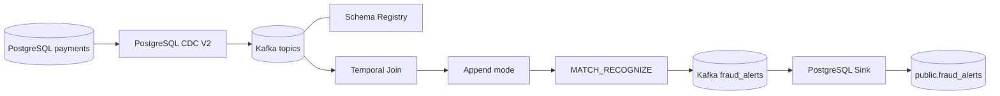

# Pipeline de pagamentos em tempo real

Projeto didático de CDC e processamento de eventos com PostgreSQL, Confluent Cloud e Flink SQL. A regra de demonstração identifica três ou mais transações positivas do mesmo cartão em uma janela de 60 segundos.

**Fluxo:** PostgreSQL → Debezium CDC → Kafka → Flink SQL (Temporal Join) → append → MATCH_RECOGNIZE → tópico Kafka `fraud_alerts` → PostgreSQL Sink → tabela `public.fraud_alerts`.

O projeto acompanha os conceitos da demonstração do mentor, com nomes e configurações próprios. Há uma diferença de ordem no teste isolado de contrato Avro e uma validação adicional do subject CDC real; consulte `docs/matriz-rastreabilidade-demo-mentor.md`. O tópico `fraud_alerts` é a saída do Flink e alimenta o PostgreSQL Sink, que grava em `public.fraud_alerts`. O Sink está preparado no código, mas ainda não foi executado nem homologado.

## Arquitetura



## Estrutura

- `database/init/`: criação do schema e carga sintética.
- `database/seed/`: cenários de transações para validação.
- `database/verify/`: consultas de alertas persistidos e auditoria da role Sink.
- `infrastructure/`: Environment, cluster, identidades, ACLs, Schema Registry e conectores CDC/Sink.
- `flink/sql/` e `flink/scripts/`: statements Flink e submissão sequencial.
- `operations/`: verificações CDC, evidências e acompanhamento de custos.
- `schemas/`: contratos Avro usados no exercício de compatibilidade.
- `evidence/`: saídas produzidas durante execuções reais.
- `teardown/`: limpeza dos recursos do laboratório.

## Pré-requisitos

- Conta Neon com um projeto PostgreSQL dedicado.
- Conta Neon e [Neon CLI](https://neon.com/docs/get-started/neon-cli) instalada (requer Node.js/npm) e autenticada (`neon auth`).
- `bash`, `psql`, `jq` e `curl`.
- Conta Confluent Cloud com acesso a Kafka, Connect, Schema Registry e Flink.
- Confluent CLI autenticada e compatível com os comandos do projeto.

## Preparação do PostgreSQL no Neon

A Fase 1 reproduz a preparação mostrada pelo mentor. Execute as etapas **nesta ordem**. A criação/configuração do conector CDC continua na Fase 2, na Confluent. Os scripts redescobrem Environment, cluster, Schema Registry e compute pool pelos nomes configurados, em vez de confiar cegamente nos IDs persistidos. 

1. Crie no Neon um projeto PostgreSQL dedicado ao laboratório.
2. Copie `.env.example` para `.env` e preencha:
   - `NEON_PROJECT_ID`: identificador do projeto Neon.
   - `NEON_BRANCH`: branch do banco (padrão `main`).
   - `PG_DATABASE`: nome do banco.
   - `PG_HOST`, `PG_PORT`, `PG_ADMIN_USER` e `PG_ADMIN_PASSWORD`: dados da connection string administrativa. Use o host direto, sem pooler.
   - `PG_SINK_USER` (padrão `alerts_sink`) e `PG_SINK_PASSWORD`: credenciais locais da role que grava os alertas.
3. Autentique a Neon CLI, se ainda não estiver:

   ```bash
   neon auth
   ```

4. Execute a etapa **00**, que habilita Logical Replication, cria a role `cdc` se ainda não existir, recupera sua credencial e atualiza `.env` sem exibir a senha:

   ```bash
   bash scripts/00-setup-neon.sh
   ```

   **Atenção:** habilitar Logical Replication pode suspender os endpoints ativos do projeto e não pode ser desfeito. O script apresenta o aviso e exige confirmação interativa antes de solicitar a alteração. A role criada pela Neon CLI recebe a associação `neon_superuser`, que inclui o privilégio `REPLICATION`.

5. Somente depois da etapa 00, execute a etapa **01**:

   ```bash
   CONFIRM_RESET=yes ./scripts/run-sql.sh database/init/01-database.sql
   ```

   O wrapper testa a conexão administrativa, exige `wal_level=logical`, verifica `LOGIN + REPLICATION` da role e testa sua autenticação **antes** de executar o SQL destrutivo. Se alguma verificação falhar, aborta sem apagar o schema.

A etapa 01 recria o schema `payments` e a tabela `public.fraud_alerts`, configura a role `alerts_sink` e carrega dados determinísticos (200 customers, 240 accounts, 320 cards, 30 merchants e 2.000 transactions), aplica `REPLICA IDENTITY FULL` às quatro tabelas capturadas e cria `payments_pub` com essas quatro tabelas. `merchants` integra o dataset do mentor, mas fica fora da publication e do escopo CDC.

**Atenção:** a etapa 01 apaga e recria `payments`. Use uma instância/banco dedicado ao laboratório e confira host e database exibidos pelo wrapper antes de confirmar.

## Ordem de execução

1. `./infrastructure/foundation.sh` — Environment, Kafka Basic, service accounts e ACLs.
2. `./infrastructure/schema-registry.sh` — Schema Registry e compatibilidade Avro.
3. `./infrastructure/connectors/cdc/connector.sh` — conector PostgreSQL CDC V2.
4. Aguarde o snapshot inicial e valide os tópicos com `./operations/verify-cdc-snapshot.sh`.

A sequência após o snapshot é: CDC incremental (Passo 5 do mentor), evolução adicional do subject CDC real (extensão deste projeto) e, depois, Flink (Passo 7). O CDC incremental oficial foi homologado em 14/11/2026, com INSERT/UPDATE/DELETE (`op=c/u/d`, `snapshot=false`), offsets 231–233. A evolução adicional do subject CDC real também foi homologada: `payments.transactions-value` evoluiu da versão 1 para 2, com compatibilidade `BACKWARD`, campo `channel` e evento correlacionado observado no tópico `payments.transactions` (partição 0, offset 2000). Evidências em `evidence/homologation/20261114T005129Z-cdc-incremental.txt` e `evidence/homologation/20261114T012247Z-real-schema-evolution.txt`. O teste isolado de compatibilidade Avro do Passo 6 do mentor é executado junto da preparação do Schema Registry, antes do conector CDC; não é a mesma operação que evoluir o subject CDC real.

O verificador inicia os quatro consumidores em paralelo e acompanha cada tópico separadamente. Cada consumidor é encerrado ao atingir a contagem esperada de eventos Debezium `op=r` (200 customers, 240 accounts, 320 cards e 2.000 transactions); os marcadores de snapshot ficam registrados apenas como diagnóstico. O timeout máximo é individual e configurável em segundos por `CDC_SNAPSHOT_TIMEOUT` (padrão: 1.800 segundos / 30 minutos; na homologação registrada em 13/11/2026, foi usado 2.400 segundos).
5. `./operations/verify-cdc-incremental.sh` — valide INSERT, UPDATE e DELETE e confirme os eventos `c`, `u` e `d` com `snapshot=false` (Passo 5 do mentor).
6. `CONFIRM_SCHEMA_EVOLUTION=yes ./infrastructure/schema-evolution.sh` — validação adicional do projeto no subject real `payments.transactions-value`; não confundir com o Passo 6 do mentor, que usa um subject isolado. Confira banco e subject antes de confirmar.
7. `./flink/scripts/run.sh` — somente depois das validações anteriores, configura startup offset, declara a PK de accounts, cria Temporal Join, append e MATCH_RECOGNIZE (Passo 7 do mentor).
8. Execute o cenário positivo: `./scripts/run-sql.sh database/seed/simulate-events.sql`.
9. Consulte os resultados no tópico `fraud_alerts` e registre as evidências.
10. Antes de criar o Sink, confira o schema Avro real do tópico e execute a auditoria read-only da role com `./scripts/run-sql.sh database/verify/alerts.sql`.
11. Somente após aprovar contrato e privilégios, execute `bash ./infrastructure/connectors/sink/connector.sh`; depois correlacione uma mensagem conhecida com a linha persistida usando a mesma consulta SQL.

A evolução real do schema é uma validação adicional deste projeto e antecede o Flink. O Passo 6 da demonstração do mentor é o teste de compatibilidade no subject isolado `contract.transactions-value`, atualmente executado dentro da preparação do Schema Registry (etapa 2), antes do CDC. As duas validações não são intercambiáveis.

**Estado em 14/11/2026:** snapshot CDC, CDC incremental oficial e evolução do subject real `payments.transactions-value` estão homologados, conforme evidências datadas em `evidence/homologation/`. No Flink, as PKs foram concluídas; enrichment e detecção foram observados em execução; o cenário positivo inseriu as transações 2002, 2003 e 2004 para o cartão 1 (R$ 100 cada) e 2005 para o cartão 320 (R$ 10). A consulta a `fraud_alerts` retornou resultados, mas os timestamps observados (05:03:20–05:03:22 UTC) antecedem os INSERTs do cenário (06:11:29 UTC). Portanto, não há correlação comprovada entre os alertas e o cenário positivo. A saída no tópico Kafka e a validação funcional da janela/watermark permanecem pendentes. O estado operacional coletado às 07:16:44 UTC registrou cluster `UP`, conector `RUNNING` e compute pool `PROVISIONED` com consumo de 2 CFUs; isso é inventário operacional, não homologação funcional. Consulte `docs/plano-homologacao.md`.

## Regra e limitações

- Particionamento lógico da regra: `card_id`.
- Padrão: três ou mais registros com `amount > 0`.
- Janela: 60 segundos de `$rowtime`, timestamp associado à chegada Kafka.
- O snapshot inicial deve terminar antes de iniciar os statements de processamento.
- Para evitar que as 2.000 transações do snapshot sejam interpretadas como uma rajada, o script define `scan.startup.mode=latest-offset` em transactions antes do Temporal Join. A dimensão accounts permanece disponível para o join.
- A conversão para append-only altera a representação do changelog para atender ao operador seguinte. Não deve ser interpretada como filtro universal de operações Debezium nem como garantia de que somente INSERTs de negócio serão contados. Atualizações/retrações podem ser representadas como novos registros conforme a semântica do plano e do conector; validar o comportamento observado antes de interpretar alertas. O cenário positivo usa INSERTs novos para demonstrar a regra.
- O Flink publica alertas em Kafka e o Sink está configurado para persistir em PostgreSQL. A persistência real permanece pendente de execução e homologação.

## Segurança e custos

Não versione `.env`, `.state.env`, arquivos renderizados ou segredos. O `.state.env` local contém IDs e credenciais, deve permanecer privado (permissão 600) e não deve ser compartilhado. A senha `PG_SINK_PASSWORD` é lida pelo `psql` diretamente do ambiente e não é passada como argumento de processo. A role `alerts_sink` é criada ou atualizada na inicialização; atributos e memberships preexistentes devem ser auditados antes de autorizar o Sink. O teardown Neon remove os objetos PostgreSQL do laboratório e as roles configuradas em `PG_CDC_USER` e `PG_SINK_USER`, após confirmação independente. A automação redescobre os recursos Confluent pelo nome; se uma API key já existir sem que seu segredo esteja disponível localmente, interrompe a execução para evitar duplicação. Execute em ambiente dedicado. Compute pool Flink e conectores gerenciados podem gerar custos enquanto provisionados/ativos. Consulte `operations/cost-and-metrics.md` antes e depois do laboratório.


## Teardown e preservação do Neon

O teardown tem duas confirmações independentes. Na etapa Confluent, informa o Environment e solicita a confirmação literal `ENV_ID/CC_ENV_NAME`; a exclusão do Environment remove os recursos associados, como cluster Kafka, Schema Registry, Connect e Flink Compute Pool. Service Accounts só são excluídas quando o estado local registra que foram criadas pelo laboratório e após confirmação literal independente `IDENTITIES/ENV_ID`. O vínculo `MetricsViewer` também só é removido quando seu marcador de criação está ativo; o teardown verifica sua ausência por nova listagem e interrompe o fluxo de identidades se uma consulta, exclusão ou verificação falhar. O relatório distingue identidades preservadas, remoção verificada e falha possivelmente parcial. Confira a página de API Keys após a exclusão: chaves Flink regionais devem ser verificadas individualmente. A exclusão de uma Service Account remove as API keys associadas a ela; chaves ligadas a usuários ou outras identidades devem ser avaliadas separadamente.

Na etapa Neon, o script apresenta `NEON_PROJECT_ID`, `NEON_BRANCH`, host e database e exige a confirmação literal `NEON_PROJECT_ID/NEON_BRANCH/PG_DATABASE`. A limpeza SQL remove `payments_slot`, `payments_pub`, o schema `payments`, `public.fraud_alerts` e as roles configuradas por `PG_CDC_USER` e `PG_SINK_USER` (normalmente `cdc` e `alerts_sink`). O projeto, branch, compute, endpoint e banco são preservados. O SQL só retorna sucesso após verificar que schema, tabela, publication, replication slot e roles-alvo estão ausentes. A remoção de roles não usa `DROP OWNED CASCADE`: dependências adicionais fazem o PostgreSQL recusar o `DROP ROLE`, preservando objetos não identificados como parte do laboratório.

As confirmações destrutivas de Confluent e Neon são independentes: autorizar a exclusão do Environment não autoriza a limpeza PostgreSQL. **A ordem operacional, porém, é obrigatória:** o script só inicia a etapa Neon depois que uma listagem da Confluent CLI confirmar que o Environment configurado está ausente, seja antes desta execução ou após a solicitação de exclusão. Se a CLI/dados Confluent estiverem indisponíveis, a exclusão for recusada, o Environment continuar listado ou a verificação posterior falhar, a etapa Neon será bloqueada e registrada no relatório. Nesse caso, corrija a situação e execute novamente o teardown. A confirmação Neon continua sendo exigida separadamente. Consulte o relatório em `evidence/teardown/`; ele distingue solicitação, verificação posterior, bloqueio e falhas.

## Estado da entrega

O PostgreSQL Sink, a tabela de destino, o script de criação e as consultas de auditoria estão preparados no código. A criação/execução do conector e a persistência dos alertas não foram homologadas. `RUNNING` não é evidência suficiente: é necessário correlacionar mensagem Kafka e linha no PostgreSQL.

Este repositório começa com histórico Git independente. Os artefatos descrevem como recriar o laboratório; sua presença não comprova execução na Confluent Cloud. Registre resultados reais em `evidence/` somente após executá-los e verificá-los.


### Evidências SQL e privacidade de caminhos

O wrapper `scripts/run-sql.sh` executa o `psql` a partir da raiz do projeto e utiliza caminhos relativos para o arquivo SQL. Os logs mostram apenas caminhos internos do repositório, e o resumo informa o caminho relativo da evidência, sem expor o diretório local da máquina. O verificador `operations/verify-cdc-snapshot.sh` também grava e apresenta somente caminhos relativos em seus resumos e mensagens; cada execução usa um identificador com timestamp e PID para evitar colisão de diretório e consumer group.


## Configuração de idleness do Flink

Por padrão, o projeto mantém a detecção progressiva de partições ociosas da Confluent. Para reproduzir o timeout fixo de 5 segundos demonstrado pelo mentor, configure no `.env`:

```bash
FLINK_IDLE_TIMEOUT="5 s"
```

O script `flink/scripts/run.sh` transmite essa configuração como propriedade de cada statement criado. Para voltar ao comportamento progressivo, deixe `FLINK_IDLE_TIMEOUT` vazio. A propriedade é aplicada somente a statements novos; o script não sobrescreve statements existentes e interrompe se encontrar nomes duplicados.

O timeout fixo pode fazer uma partição ser excluída mais cedo do cálculo de watermark. Se ela voltar a produzir eventos atrasados, o watermark pode já ter avançado. Compare watermarks e resultados antes de escolher a configuração.

### Verificações operacionais

`operations/verify-metrics.sh` automatiza a coleta read-only de `received_bytes` pela Confluent Metrics API e salva o JSON original e um resumo datado em `evidence/observability/`. Requer `METRICS_API_KEY`, `METRICS_API_SECRET` e `CLUSTER_ID` no ambiente local. `operations/verify-billing.sh` consulta custos agregados pela Costs API usando a sessão autenticada da Confluent CLI; exige `OrganizationAdmin` ou `BillingAdmin` e gera JSON e resumo datados. A Costs API pode atrasar até 72 horas e não informa o saldo restante dos créditos promocionais. Consulte `operations/cost-and-metrics.md` para interpretação e limites. O orquestrador geral de observabilidade será adicionado após a implementação dos verificadores individuais de ACLs, Billing e confiabilidade.

