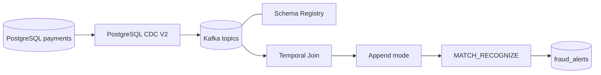

# Pipeline de pagamentos em tempo real

Projeto didático de CDC e processamento de eventos com PostgreSQL, Confluent Cloud e Flink SQL. A regra de demonstração identifica três ou mais transações positivas do mesmo cartão em uma janela de 60 segundos.

**Fluxo:** PostgreSQL → Debezium CDC → Kafka → Flink SQL (Temporal Join) → append → MATCH_RECOGNIZE → tópico Kafka de alertas.

O projeto acompanha a estrutura e a sequência didática da demonstração do mentor, com nomes e configurações próprios. O destino da solução é o tópico Kafka `fraud_alerts`; não há PostgreSQL Sink no fluxo principal.

## Arquitetura



## Estrutura

- `database/init/`: criação do schema e carga sintética.
- `database/seed/`: cenários de transações para validação.
- `infrastructure/`: Environment, cluster, identidades, ACLs, Schema Registry e conector CDC.
- `flink/sql/` e `flink/scripts/`: statements Flink e submissão sequencial.
- `operations/`: verificações CDC, evidências e acompanhamento de custos.
- `schemas/`: contratos Avro usados no exercício de compatibilidade.
- `evidence/`: saídas produzidas durante execuções reais.
- `teardown/`: limpeza dos recursos do laboratório.

## Pré-requisitos

- Conta Confluent Cloud com acesso a Kafka, Connect, Schema Registry e Flink.
- Confluent CLI autenticada e compatível com os comandos do projeto.
- PostgreSQL com logical replication e acesso de rede pelo conector gerenciado.
- `bash`, `psql`, `jq` e `curl`.

## Preparação do PostgreSQL

A Fase 1 reproduz a preparação mostrada pelo mentor. Ela termina com o banco, o dataset e a publication prontos; não cria nem configura o conector CDC na Confluent.

1. Crie um projeto PostgreSQL dedicado no Neon e habilite **Logical Replication** nas configurações do projeto. Copie `.env.example` para `.env` (`cp .env.example .env`) e preencha os parâmetros localmente. Essa alteração reinicia os computes; confirme o impacto antes de habilitá-la.
2. Copie a connection string administrativa usando o **host direto**, sem pooler. Preencha no `.env`: `PG_HOST`, `PG_PORT`, `PG_DATABASE`, `PG_ADMIN_USER` e `PG_ADMIN_PASSWORD`.
3. Crie a role de conexão no Neon pela CLI, conforme o procedimento do provedor:

```bash
neon roles create --name cdc
```

Configure `PG_CDC_USER=cdc` e obtenha a credencial da role localmente, sem expor a connection string:

```bash
neon connection-string main --project-id <PROJECT_ID> --role-name cdc --database-name <PG_DATABASE> --ssl require
```

Extraia a senha no próprio terminal e preencha `PG_CDC_PASSWORD` no `.env`. A role precisa ter `LOGIN` e `REPLICATION`; não tente conceder o atributo por SQL se o provedor o administra. O wrapper valida também a autenticação dessa role antes de executar o reset.
4. Confira o alvo e inicialize:

```bash
CONFIRM_RESET=yes ./scripts/run-sql.sh database/init/00-database.sql
```

O wrapper testa a conexão, exige `wal_level=logical` e verifica `LOGIN + REPLICATION` da role **antes** de executar o SQL destrutivo. Se qualquer verificação falhar, aborta sem apagar o schema.

A inicialização recria somente o schema `payments`, carrega dados determinísticos (200 customers, 240 accounts, 320 cards, 30 merchants e 2.000 transactions), aplica `REPLICA IDENTITY FULL` às quatro tabelas capturadas e cria `payments_pub` com essas quatro tabelas. `merchants` integra o dataset do mentor, mas fica fora da publication e do escopo CDC.

**Atenção:** o comando de inicialização apaga e recria `payments`. Use uma instância/banco dedicado ao laboratório e confira host e database exibidos pelo wrapper antes de confirmar.

## Ordem de execução

1. `./infrastructure/foundation.sh` — Environment, Kafka Basic, service accounts e ACLs.
2. `./infrastructure/schema-registry.sh` — Schema Registry e compatibilidade Avro.
3. `./infrastructure/connectors/cdc/connector.sh` — conector PostgreSQL CDC V2.
4. Aguarde o snapshot inicial e valide os tópicos com `./operations/verify-cdc-snapshot.sh`.
5. `./flink/scripts/run.sh` — configura startup offset, declara PKs, cria Temporal Join, append e MATCH_RECOGNIZE.
6. Execute o cenário positivo: `./scripts/run-sql.sh database/seed/simulate-events.sql`.
7. Consulte os resultados no tópico `fraud_alerts` e registre as evidências.
8. Execute `./operations/verify-cdc-incremental.sh` para validar INSERT, UPDATE e DELETE na tabela customers.

A evolução do schema real é opcional e pode ser demonstrada com `./infrastructure/schema-evolution.sh`.

## Regra e limitações

- Particionamento lógico da regra: `card_id`.
- Padrão: três ou mais registros com `amount > 0`.
- Janela: 60 segundos de `$rowtime`, timestamp associado à chegada Kafka.
- O snapshot inicial deve terminar antes de iniciar os statements de processamento.
- Para evitar que as 2.000 transações do snapshot sejam interpretadas como uma rajada, o script define `scan.startup.mode=latest-offset` em transactions antes do Temporal Join. A dimensão accounts permanece disponível para o join.
- O modo append não filtra eventos Debezium por operação: eventos de criação/leitura/atualização são tratados como novas linhas, enquanto exclusões são ignoradas. Assim, atualizações CDC podem contribuir para a contagem de padrões; a regra não equivale a contar exclusivamente INSERTs de negócio. O cenário positivo usa INSERTs novos para demonstrar a regra.
- O resultado é um fluxo de alertas no Kafka, não uma persistência em banco de destino.

## Segurança e custos

Não versione `.env`, `.state.env`, arquivos renderizados ou segredos. Execute em ambiente dedicado. Compute pool Flink e conectores gerenciados podem gerar custos enquanto provisionados/ativos. Consulte `operations/cost-and-metrics.md` antes e depois do laboratório.

## Estado da entrega

Este repositório começa com histórico Git independente. Os artefatos descrevem como recriar o laboratório; sua presença não comprova execução na Confluent Cloud. Registre resultados reais em `evidence/` somente após executá-los e verificá-los.
