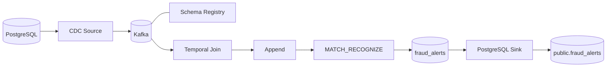

# Pipeline de pagamentos em tempo real

Este repositório apresenta um projeto acadêmico desenvolvido como desafio final do bootcamp **IBM Confluent - Dados em tempo real para agentes de IA**, oferecido pela [DIO](https://www.dio.me/) em parceria com IBM e Confluent. O trabalho tem finalidade educacional: aplicar conceitos de integração de dados em tempo real, Change Data Capture (CDC), streaming e processamento de eventos em uma arquitetura de pagamentos.

O projeto utiliza PostgreSQL, Confluent Cloud, Kafka, Schema Registry, conectores e Flink SQL para demonstrar um fluxo de eventos e uma regra didática de detecção de possíveis transações suspeitas. É um projeto independente, não um produto oficial nem uma implementação certificada ou endossada pela DIO, IBM ou Confluent.

**Fluxo:** PostgreSQL → Debezium CDC → Kafka → Flink SQL → tópico `fraud_alerts` → PostgreSQL Sink.

O objetivo é capturar alterações no banco, enriquecer transações com dados de contas e identificar três ou mais transações positivas do mesmo cartão em até 60 segundos de tempo de evento Kafka.

### Organização da execução

A execução foi documentada em etapas, com scripts específicos para partes do fluxo. **Não foi criado um script único que provisiona e executa todos os recursos de uma só vez.** Essa escolha é intencional: o usuário percorre as etapas, acompanha a criação e a configuração dos recursos na Neon e na Confluent Cloud, observa seus estados e valida os resultados de cada componente. A proposta é proporcionar experiência prática com o provisionamento e a integração dos serviços, em vez de ocultar todo o processo atrás de uma automação única.

Os scripts automatizam tarefas delimitadas, mas não substituem a leitura das instruções, as confirmações exigidas nem a validação de cada etapa. Siga a sequência deste README e avance somente após conferir os resultados esperados.

## Arquitetura



## 1. Pré-requisitos

- PostgreSQL dedicado ao laboratório, acessível pela Confluent Cloud e compatível com logical replication.
- Conta Confluent Cloud com acesso a Kafka, Connect, Schema Registry e Flink.
- Conta Neon e [Neon CLI](https://neon.com/docs/get-started/neon-cli) instalada e autenticada.
- [Confluent CLI](https://docs.confluent.io/confluent-cli/current/install.html) instalada e autenticada.
- Bash, `psql`, `jq`, `curl`, `openssl` e Node.js/npm (para instalar a Neon CLI).

Confira a região, os créditos e os limites de custo antes de criar recursos. Consulte [Custos e métricas](operations/cost-and-metrics.md).

## 2. Preparar o ambiente local

Na raiz do repositório:

```bash
cp .env.example .env
```

Preencha o arquivo `.env`:

| Variável | Uso |
|---|---|
| `CC_CLOUD`, `CC_REGION` | Nuvem e região da Confluent |
| `CC_ENV_NAME` | Nome do Environment |
| `CC_CLUSTER_NAME` | Nome do cluster Kafka |
| `CC_FLINK_POOL_NAME` | Nome do compute pool Flink |
| `NEON_PROJECT_ID`, `NEON_BRANCH` | Projeto e branch Neon |
| `PG_HOST`, `PG_PORT`, `PG_DATABASE` | Endereço e banco PostgreSQL |
| `PG_ADMIN_USER`, `PG_ADMIN_PASSWORD` | Credenciais administrativas do PostgreSQL |
| `PG_SINK_USER`, `PG_SINK_PASSWORD` | Credenciais locais da role de destino |

Use o host PostgreSQL direto, sem pooler. O usuário `alerts_sink` é criado/configurado pela inicialização do banco. Gere sua senha localmente:

```bash
openssl rand -hex 24
```

Copie o resultado para `PG_SINK_PASSWORD` no `.env`. Não reutilize a senha administrativa nem compartilhe ou versione credenciais.

Autentique a Confluent CLI, se necessário:

```bash
confluent login
```

A etapa Neon gera e grava `PG_CDC_PASSWORD` no `.env`; não preencha essa senha manualmente. O arquivo `.state.env` é criado pelos scripts para armazenar IDs e credenciais da Confluent. Ambos são locais e privados.

## 3. Preparar o PostgreSQL no Neon

Execute na ordem:

1. Crie um projeto Neon dedicado ao laboratório.
2. Preencha no `.env` as variáveis Neon e PostgreSQL da etapa anterior.
3. Autentique a CLI, se necessário:

   ```bash
   neon auth
   ```

4. Habilite logical replication e prepare a role CDC:

   ```bash
   bash scripts/00-setup-neon.sh
   ```

   **Atenção:** habilitar logical replication pode suspender endpoints ativos do projeto e não pode ser desfeito. Leia o aviso e confirme somente depois de conferir o projeto e a branch.

5. Inicialize o schema e os dados:

   ```bash
   CONFIRM_RESET=yes ./scripts/run-sql.sh database/init/01-database.sql
   ```

   Essa etapa é destrutiva para o schema `payments` e a tabela `public.fraud_alerts`: recria os objetos e carrega dados determinísticos (200 customers, 240 accounts, 320 cards, 30 merchants e 2.000 transactions). Use um banco dedicado e confira host e database antes de confirmar.

O wrapper valida a conexão, a configuração de logical replication e a autenticação da role CDC antes de executar o SQL.

## 4. Provisionar a fundação Confluent

```bash
./infrastructure/foundation.sh
```

O script prepara o Environment, o cluster Kafka Basic, as Service Accounts, API keys e ACLs. Confira a saída e a evidência em `evidence/cloud/01-foundation.txt` antes de avançar.

## 5. Preparar o Schema Registry

```bash
./infrastructure/schema-registry.sh
```

O script configura compatibilidade Avro `BACKWARD` e testa a evolução de contrato: um campo opcional com default é aceito; um campo obrigatório sem default é rejeitado. A evidência fica em `evidence/cloud/02-schema-registry.txt`.

Execute uma única vez por subject. Se o subject já existir, inspecione suas versões; não tente recriar ou repetir a etapa automaticamente.

## 6. Criar o conector PostgreSQL CDC

Após a inicialização do banco:

```bash
./infrastructure/connectors/cdc/connector.sh
```

O script verifica a role CDC e a ausência do replication slot esperado antes de criar o conector. Ele publica os eventos das tabelas `customers`, `accounts`, `cards` e `transactions` nos tópicos `payments.*`.

Confirme o conector em `RUNNING` e consulte `evidence/cloud/03-cdc-connector.txt`. Esse estado não significa que o snapshot terminou.

## 7. Validar o snapshot inicial

```bash
./operations/verify-cdc-snapshot.sh
```

O verificador acompanha os quatro tópicos e conta os eventos Debezium de snapshot (`op=r`). **Esta validação pode demorar vários minutos**, pois depende da publicação e leitura dos eventos do snapshot no Kafka. Os quatro consumidores são iniciados em paralelo; o tempo varia conforme o volume e o ritmo de processamento. O timeout padrão é de 2.400 segundos (40 minutos) por tópico, configurável pela variável `CDC_SNAPSHOT_TIMEOUT`.

| Tópico | Quantidade esperada |
|---|---:|
| `payments.customers` | 200 |
| `payments.accounts` | 240 |
| `payments.cards` | 320 |
| `payments.transactions` | 2.000 |

Avance somente quando as quatro contagens forem atingidas. Os logs e o resumo são gravados em `evidence/homologation/`.

## 8. Validar o CDC incremental

Antes de iniciar o Flink:

```bash
./operations/verify-cdc-incremental.sh
```

O script cria um registro temporário, executa INSERT, UPDATE e DELETE e procura os eventos Debezium correspondentes (`op=c`, `op=u`, `op=d`) com `snapshot=false`. Confirme os três eventos correlacionados na evidência gerada em `evidence/homologation/`.

## 9. Validar a evolução do schema CDC real

Esta etapa complementar altera a tabela `payments.transactions`, adiciona a coluna `channel` e provoca uma nova versão no subject Avro real do conector. Confira o banco e o subject antes de executar:

```bash
CONFIRM_SCHEMA_EVOLUTION=yes ./infrastructure/schema-evolution.sh
```

Confirme na evidência que o novo schema foi publicado, que a compatibilidade foi aceita e que o evento correspondente chegou ao tópico. Esse teste é diferente do teste de contrato isolado realizado na etapa 5.

## 10. Criar o Flink Compute Pool

A fundação não cria o compute pool. Antes de executar os statements, crie um pool no Environment preparado na etapa 4. O script Flink não cria esse recurso automaticamente.

Carregue as configurações locais e o ID do Environment salvo pela fundação:

```bash
source .env
source .state.env
```

Crie o pool com a região e o nome definidos no `.env`:

```bash
confluent flink compute-pool create "$CC_FLINK_POOL_NAME" \
  --cloud "$CC_CLOUD" \
  --region "$CC_REGION" \
  --max-cfu 5 \
  --environment "$ENV_ID"
```

O exemplo define limite máximo de 5 CFUs; ajuste esse limite conscientemente às necessidades e aos custos do laboratório. Consulte o estado até aparecer como `PROVISIONED`:

```bash
confluent flink compute-pool list --environment "$ENV_ID"
```

A criação exige permissão Confluent adequada, como `FlinkAdmin`. Consulte a [documentação oficial de criação de compute pools](https://docs.confluent.io/confluent-cli/current/command-reference/flink/compute-pool/confluent_flink_compute-pool_create.html).

## 11. Executar os statements Flink

Somente depois das validações anteriores:

```bash
./flink/scripts/run.sh
```

O script submete, em sequência, as declarações de chave de `accounts` e `transactions`, o Temporal Join, a transformação append e a detecção com `MATCH_RECOGNIZE`. Ele não cria compute pool automaticamente e interrompe se encontrar statements com os nomes esperados; não os exclui nem sobrescreve.

A configuração opcional `FLINK_IDLE_TIMEOUT` aceita valores como `5 s`. Vazia, mantém a detecção progressiva padrão da Confluent. A propriedade é aplicada aos statements contínuos criados pelo script.

Confira os estados e a evidência `evidence/cloud/04-flink.txt`. Para inspecionar os dados:

```bash
./flink/scripts/checks.sh
```

Estados `RUNNING` ou `COMPLETED` comprovam apenas o estado dos statements, não a correção funcional do processamento.

## 12. Testar e validar a detecção

Confirme que enrichment e detecção estão em `RUNNING`. Em seguida, execute o cenário positivo:

```bash
./scripts/run-sql.sh database/seed/simulate-events.sql
```

O SQL insere três transações positivas para o mesmo cartão e uma transação para outro cartão. Aguardar o intervalo previsto no SQL não garante, por si só, a emissão de alerta.

Consulte a saída Flink:

```bash
./flink/scripts/test-fraud-scenario.sh
```

O cenário negativo é opcional e testa três transações do mesmo cartão espaçadas além da janela:

```bash
./scripts/run-sql.sh database/seed/slow-pattern.sql
```

Observe o resultado no Flink; a ausência de alerta só pode ser concluída depois de considerar o processamento e os watermarks.

Para correlacionar o alerta com o cenário, use os limites UTC observados na execução:

```bash
./operations/verify-fraud-alerts.sh 'AAAA-MM-DD HH:MM:SS.mmm' 'AAAA-MM-DD HH:MM:SS.mmm'
```

A validação só é aprovada quando o resultado confirma um alerta do cartão esperado, com pelo menos três transações e timestamps dentro da janela informada. Preserve os statements para diagnóstico se a validação falhar. Após aprovação, pare os statements contínuos usando o caminho exato da evidência aprovada:

```bash
./flink/scripts/stop-after-validation.sh evidence/homologation/<arquivo-de-validacao-aprovada>
```

O encerrador exige evidência aprovada recente e confirma o estado `STOPPED`; não exclui os statements.

## 13. Preparar a persistência PostgreSQL (Sink)

O Sink é uma etapa posterior e só deve ser criado depois de validar a saída Kafka e revisar o contrato Avro e os privilégios PostgreSQL.

Antes da auditoria, confira a mensagem no tópico Kafka `fraud_alerts`. As credenciais e o endpoint do Schema Registry já foram salvos em `.state.env`:

```bash
source .env
source .state.env
confluent kafka topic consume fraud_alerts \
  --from-beginning \
  --value-format avro \
  --print-offset \
  --schema-registry-endpoint "$SR_URL" \
  --schema-registry-api-key "$SR_API_KEY" \
  --schema-registry-api-secret "$SR_API_SECRET" \
  --api-key "$READER_API_KEY" \
  --api-secret "$READER_API_SECRET" \
  --bootstrap "$BOOTSTRAP" \
  --cluster "$CLUSTER_ID" \
  --environment "$ENV_ID"
```

Interrompa o consumidor com `Ctrl+C` depois de observar a mensagem relevante. Registre tópico, partição, offset e conteúdo necessário para correlacionar a entrega.

Primeiro, faça a auditoria read-only da role e da tabela:

```bash
./scripts/run-sql.sh database/verify/alerts.sql
```

Confira especialmente os atributos e memberships da role `alerts_sink`. A inicialização atualiza sua senha, mas não normaliza privilégios elevados ou memberships preexistentes.

Depois de aprovar o schema e os privilégios:

```bash
./infrastructure/connectors/sink/connector.sh
```

O conector usa UPSERT em `public.fraud_alerts`. Quando estiver `RUNNING`, valide a persistência:

```bash
./scripts/run-sql.sh database/verify/alerts.sql
```

`RUNNING` não comprova gravação. A homologação exige correlacionar uma mensagem conhecida do tópico `fraud_alerts` com a linha correspondente no PostgreSQL e testar a reentrega com a mesma chave.

## 14. Encerramento e segurança

- Não versione `.env`, `.state.env`, arquivos renderizados ou segredos.
- Não repita scripts de criação sem conferir se os recursos já existem. Alguns interrompem deliberadamente diante de recursos ou subjects preexistentes.
- Registre em `evidence/` somente resultados realmente observados; scripts presentes no repositório não comprovam execução.
- Consulte [Custos e métricas](operations/cost-and-metrics.md) durante o laboratório. Recursos provisionados podem gerar custos mesmo sem tráfego.
- Quando terminar, revise dependências e inventário antes do teardown. A limpeza exige confirmações independentes para Confluent e Neon e pode remover recursos e objetos do banco:

  ```bash
  ./teardown/cleanup.sh
  ```

  Leia cada resumo e confirmação. Não autorize a limpeza Neon sem confirmar que o Environment Confluent está ausente e que o alvo PostgreSQL está correto.

## Aprendizados e limites técnicos

- `$rowtime` representa o tempo de evento associado à chegada Kafka; não é o timestamp de negócio `created_at`.
- Chaves Flink declaradas como `NOT ENFORCED` são metadados e não validam unicidade na origem.
- A transformação append não filtra exclusivamente INSERTs: eventos CDC de criação, snapshot e atualização podem ser tratados como novas linhas; exclusões são ignoradas conforme o SQL.
- A janela de 60 segundos depende do processamento temporal e dos watermarks do Flink. A espera do cenário não garante emissão imediata em relógio de parede.
- UPSERT pode tornar reentregas com a mesma chave idempotentes no destino, mas não garante exactly-once ponta a ponta.
- Uma etapa só está homologada quando há evidência correlacionada do resultado esperado. A existência de código, a execução sem erro ou o estado `RUNNING` não bastam.

## Documentação técnica

- [Requisitos e critérios de aceite](docs/requisitos.md)
- [Arquitetura](docs/arquitetura.md)
- [Decisões técnicas](docs/decisoes-tecnicas.md)
- [Rastreabilidade da demonstração](docs/matriz-rastreabilidade-demo-mentor.md)
- [Plano detalhado de homologação](docs/plano-homologacao.md)
- [Custos e métricas](operations/cost-and-metrics.md)
