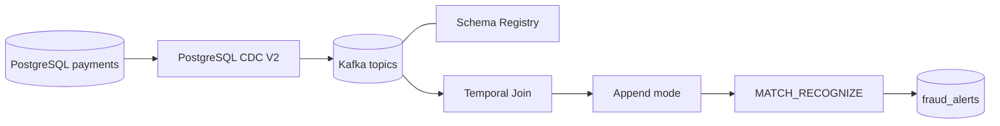

# Pipeline de pagamentos em tempo real

Projeto didático de CDC e processamento de eventos com PostgreSQL, Confluent Cloud e Flink SQL. A regra de demonstração identifica três ou mais transações positivas do mesmo cartão em uma janela de 60 segundos.

**Fluxo:** PostgreSQL → Debezium CDC → Kafka → Flink SQL (Temporal Join) → append → MATCH_RECOGNIZE → tópico Kafka de alertas.

O projeto acompanha a estrutura e a sequência didática da demonstração do mentor, com nomes e configurações próprios. O destino da solução é o tópico Kafka `fraud_alerts`; não há PostgreSQL Sink no fluxo principal.

## Arquitetura



## Estrutura

- `database/init/`: criação do schema e carga sintética.
- `database/seed/`: cenários de transações para validação.
- `infrastructure/`: Environment, cluster, identidades, ACLs, Schema Registry e conector CDC.
- `flink/sql/` e `flink/scripts/`: statements Flink e submissão sequencial.
- `operations/`: verificações CDC, evidências e acompanhamento de custos.
- `schemas/`: contratos Avro usados no exercício de compatibilidade.
- `evidence/`: saídas produzidas durante execuções reais.
- `teardown/`: limpeza dos recursos do laboratório.

## Pré-requisitos

- Conta Confluent Cloud com acesso a Kafka, Connect, Schema Registry e Flink.
- Confluent CLI autenticada e compatível com os comandos do projeto.
- PostgreSQL com logical replication e acesso de rede pelo conector gerenciado.
- `bash`, `psql`, `jq` e `curl`.

## Configuração PostgreSQL

1. Copie `.env.example` para `.env` e preencha os dados da conexão e o nome da role CDC.
2. Prepare uma instância dedicada ao laboratório.
3. Antes da inicialização, crie no PostgreSQL uma role dedicada com `LOGIN` e `REPLICATION`, usando o nome informado em `PG_CDC_USER`. Defina a senha correspondente em `PG_CDC_PASSWORD`. O usuário administrador configurado em `PG_ADMIN_USER` precisa ter permissão para conceder acesso à role.
4. Inicialize o banco somente após conferir host, database e usuário:

```bash
CONFIRM_RESET=yes ./scripts/run-sql.sh database/init/00-database.sql
```

A inicialização remove e recria o schema `payments`. Não a execute em banco com dados a preservar. A role CDC não é criada pelo script, pois provedores gerenciados podem restringir a criação de roles com atributo REPLICATION.

## Ordem de execução

1. `./infrastructure/foundation.sh` — Environment, Kafka Basic, service accounts e ACLs.
2. `./infrastructure/schema-registry.sh` — Schema Registry e compatibilidade Avro.
3. `./infrastructure/connectors/cdc/connector.sh` — conector PostgreSQL CDC V2.
4. Aguarde o snapshot inicial e valide os tópicos com `./operations/verify-cdc-snapshot.sh`.
5. `./flink/scripts/run.sh` — configura startup offset, declara PKs, cria Temporal Join, append e MATCH_RECOGNIZE.
6. Execute o cenário positivo: `./scripts/run-sql.sh database/seed/simulate-events.sql`.
7. Consulte os resultados no tópico `fraud_alerts` e registre as evidências.
8. Opcional: execute `database/seed/slow-pattern.sql` para testar eventos espaçados.

A evolução do schema real é opcional e pode ser demonstrada com `./infrastructure/schema-evolution.sh`.

## Regra e limitações

- Particionamento lógico da regra: `card_id`.
- Padrão: três ou mais registros com `amount > 0`.
- Janela: 60 segundos de `$rowtime`, timestamp associado à chegada Kafka.
- O snapshot inicial deve terminar antes de iniciar os statements de processamento.
- Para evitar que as 2.000 transações do snapshot sejam interpretadas como uma rajada, o script define `scan.startup.mode=latest-offset` em transactions antes do Temporal Join. A dimensão accounts permanece disponível para o join.
- O modo append não filtra eventos Debezium por operação. UPDATE/DELETE podem ser representados como novas linhas; portanto, o cenário de fraude deve usar INSERTs novos. A solução reproduz a sequência do mentor e não pretende oferecer tratamento completo de changelog.
- O resultado é um fluxo de alertas no Kafka, não uma persistência em banco de destino.

## Segurança e custos

Não versione `.env`, `.state.env`, arquivos renderizados ou segredos. Execute em ambiente dedicado. Compute pool Flink e conectores gerenciados podem gerar custos enquanto provisionados/ativos. Consulte `operations/cost-and-metrics.md` antes e depois do laboratório.

## Estado da entrega

Este repositório começa com histórico Git independente. Os artefatos descrevem como recriar o laboratório; sua presença não comprova execução na Confluent Cloud. Registre resultados reais em `evidence/` somente após executá-los e verificá-los.
