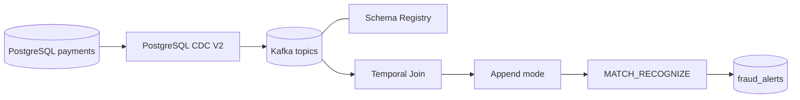

# Pipeline de pagamentos em tempo real

Projeto didático de CDC e processamento de eventos com PostgreSQL, Confluent Cloud e Flink SQL. A regra de demonstração identifica três ou mais transações positivas do mesmo cartão em uma janela de 60 segundos.

**Fluxo:** PostgreSQL → Debezium CDC → Kafka → Flink SQL (Temporal Join) → append → MATCH_RECOGNIZE → tópico Kafka de alertas.

O projeto acompanha os conceitos da demonstração do mentor, com nomes e configurações próprios. Há uma diferença de ordem no teste isolado de contrato Avro e uma validação adicional do subject CDC real; consulte `docs/matriz-rastreabilidade-demo-mentor.md`. O destino da solução é o tópico Kafka `fraud_alerts`; não há PostgreSQL Sink no fluxo principal.

## Arquitetura



## Estrutura

- `database/init/`: criação do schema e carga sintética.
- `database/seed/`: cenários de transações para validação.
- `infrastructure/`: Environment, cluster, identidades, ACLs, Schema Registry e conector CDC.
- `flink/sql/` e `flink/scripts/`: statements Flink e submissão sequencial.
- `operations/`: verificações CDC, evidências e acompanhamento de custos.
- `schemas/`: contratos Avro usados no exercício de compatibilidade.
- `evidence/`: saídas produzidas durante execuções reais.
- `teardown/`: limpeza dos recursos do laboratório.

## Pré-requisitos

- Conta Neon com um projeto PostgreSQL dedicado.
- Conta Neon e [Neon CLI](https://neon.com/docs/get-started/neon-cli) instalada (requer Node.js/npm) e autenticada (`neon auth`).
- `bash`, `psql`, `jq` e `curl`.
- Conta Confluent Cloud com acesso a Kafka, Connect, Schema Registry e Flink.
- Confluent CLI autenticada e compatível com os comandos do projeto.

## Preparação do PostgreSQL no Neon

A Fase 1 reproduz a preparação mostrada pelo mentor. Execute as etapas **nesta ordem**. A criação/configuração do conector CDC continua na Fase 2, na Confluent. Os scripts redescobrem Environment, cluster, Schema Registry e compute pool pelos nomes configurados, em vez de confiar cegamente nos IDs persistidos. 

1. Crie no Neon um projeto PostgreSQL dedicado ao laboratório.
2. Copie `.env.example` para `.env` e preencha:
   - `NEON_PROJECT_ID`: identificador do projeto Neon.
   - `NEON_BRANCH`: branch do banco (padrão `main`).
   - `PG_DATABASE`: nome do banco.
   - `PG_HOST`, `PG_PORT`, `PG_ADMIN_USER` e `PG_ADMIN_PASSWORD`: dados da connection string administrativa. Use o host direto, sem pooler.
3. Autentique a Neon CLI, se ainda não estiver:

   ```bash
   neon auth
   ```

4. Execute a etapa **00**, que habilita Logical Replication, cria a role `cdc` se ainda não existir, recupera sua credencial e atualiza `.env` sem exibir a senha:

   ```bash
   bash scripts/00-setup-neon.sh
   ```

   **Atenção:** habilitar Logical Replication pode suspender os endpoints ativos do projeto e não pode ser desfeito. O script apresenta o aviso e exige confirmação interativa antes de solicitar a alteração. A role criada pela Neon CLI recebe a associação `neon_superuser`, que inclui o privilégio `REPLICATION`.

5. Somente depois da etapa 00, execute a etapa **01**:

   ```bash
   CONFIRM_RESET=yes ./scripts/run-sql.sh database/init/01-database.sql
   ```

   O wrapper testa a conexão administrativa, exige `wal_level=logical`, verifica `LOGIN + REPLICATION` da role e testa sua autenticação **antes** de executar o SQL destrutivo. Se alguma verificação falhar, aborta sem apagar o schema.

A etapa 01 recria somente o schema `payments`, carrega dados determinísticos (200 customers, 240 accounts, 320 cards, 30 merchants e 2.000 transactions), aplica `REPLICA IDENTITY FULL` às quatro tabelas capturadas e cria `payments_pub` com essas quatro tabelas. `merchants` integra o dataset do mentor, mas fica fora da publication e do escopo CDC.

**Atenção:** a etapa 01 apaga e recria `payments`. Use uma instância/banco dedicado ao laboratório e confira host e database exibidos pelo wrapper antes de confirmar.

## Ordem de execução

1. `./infrastructure/foundation.sh` — Environment, Kafka Basic, service accounts e ACLs.
2. `./infrastructure/schema-registry.sh` — Schema Registry e compatibilidade Avro.
3. `./infrastructure/connectors/cdc/connector.sh` — conector PostgreSQL CDC V2.
4. Aguarde o snapshot inicial e valide os tópicos com `./operations/verify-cdc-snapshot.sh`.

A sequência após o snapshot é: CDC incremental (Passo 5 do mentor), evolução adicional do subject CDC real (extensão deste projeto) e, depois, Flink (Passo 7). O fluxo incremental c/u/d foi observado em teste temporário em 14/11/2026. A primeira execução do verificador oficial realizou as operações SQL e a limpeza, mas não registrou mensagens Kafka e terminou com código 1; o script foi então adaptado para reproduzir o comando do teste temporário. A nova versão ainda aguarda execução. A evolução do subject CDC real também permanece pendente. O teste isolado de compatibilidade Avro do Passo 6 do mentor é executado junto da preparação do Schema Registry, antes do conector CDC; não é a mesma operação que evoluir o subject CDC real.

O verificador inicia os quatro consumidores em paralelo e acompanha cada tópico separadamente. Cada consumidor é encerrado ao atingir a contagem esperada de eventos Debezium `op=r` (200 customers, 240 accounts, 320 cards e 2.000 transactions); os marcadores de snapshot ficam registrados apenas como diagnóstico. O timeout máximo é individual e configurável em segundos por `CDC_SNAPSHOT_TIMEOUT` (padrão: 1.800 segundos / 30 minutos; na homologação registrada em 13/11/2026, foi usado 2.400 segundos).
5. `./operations/verify-cdc-incremental.sh` — valide INSERT, UPDATE e DELETE e confirme os eventos `c`, `u` e `d` com `snapshot=false` (Passo 5 do mentor).
6. `CONFIRM_SCHEMA_EVOLUTION=yes ./infrastructure/schema-evolution.sh` — validação adicional do projeto no subject real `payments.transactions-value`; não confundir com o Passo 6 do mentor, que usa um subject isolado. Confira banco e subject antes de confirmar.
7. `./flink/scripts/run.sh` — somente depois das validações anteriores, configura startup offset, declara a PK de accounts, cria Temporal Join, append e MATCH_RECOGNIZE (Passo 7 do mentor).
8. Execute o cenário positivo: `./scripts/run-sql.sh database/seed/simulate-events.sql`.
9. Consulte os resultados no tópico `fraud_alerts` e registre as evidências.

A evolução real do schema é uma validação adicional deste projeto e antecede o Flink. O Passo 6 da demonstração do mentor é o teste de compatibilidade no subject isolado `contract.transactions-value`, atualmente executado dentro da preparação do Schema Registry (etapa 2), antes do CDC. As duas validações não são intercambiáveis.

**Estado confirmado em 14/11/2026:** snapshot CDC homologado, com 2.760/2.760 eventos `op=r` e evidências em `evidence/homologation/20261113T185152Z-24189-cdc-snapshot/`. Um teste temporário de CDC incremental observou INSERT, UPDATE e DELETE (`op=c/u/d`, `snapshot=false`), com offsets 223, 224 e 225, registrados localmente em `evidence/homologation/20261114T001704Z-cdc-offset-test.txt`. Isso comprova o fluxo incremental naquela execução, mas não a execução do verificador oficial. `operations/verify-cdc-incremental.sh` foi corrigido para usar grupo exclusivo `snapshot-check-*`, já coberto pela ACL prefixada da fundação, e aguarda execução oficial; portanto, a etapa oficial ainda não está homologada. A evolução do subject real `payments.transactions-value` permanece pendente. Flink teve revisão estática concluída, mas ainda não foi executado na nuvem.

## Regra e limitações

- Particionamento lógico da regra: `card_id`.
- Padrão: três ou mais registros com `amount > 0`.
- Janela: 60 segundos de `$rowtime`, timestamp associado à chegada Kafka.
- O snapshot inicial deve terminar antes de iniciar os statements de processamento.
- Para evitar que as 2.000 transações do snapshot sejam interpretadas como uma rajada, o script define `scan.startup.mode=latest-offset` em transactions antes do Temporal Join. A dimensão accounts permanece disponível para o join.
- A conversão para append-only altera a representação do changelog para atender ao operador seguinte. Não deve ser interpretada como filtro universal de operações Debezium nem como garantia de que somente INSERTs de negócio serão contados. Atualizações/retrações podem ser representadas como novos registros conforme a semântica do plano e do conector; validar o comportamento observado antes de interpretar alertas. O cenário positivo usa INSERTs novos para demonstrar a regra.
- O resultado é um fluxo de alertas no Kafka, não uma persistência em banco de destino.

## Segurança e custos

Não versione `.env`, `.state.env`, arquivos renderizados ou segredos. O `.state.env` local contém IDs e credenciais, deve permanecer privado (permissão 600) e não deve ser compartilhado. A automação redescobre os recursos Confluent pelo nome; se uma API key já existir sem que seu segredo esteja disponível localmente, interrompe a execução para evitar duplicação. Execute em ambiente dedicado. Compute pool Flink e conectores gerenciados podem gerar custos enquanto provisionados/ativos. Consulte `operations/cost-and-metrics.md` antes e depois do laboratório.

## Estado da entrega

Este repositório começa com histórico Git independente. Os artefatos descrevem como recriar o laboratório; sua presença não comprova execução na Confluent Cloud. Registre resultados reais em `evidence/` somente após executá-los e verificá-los.


### Evidências SQL e privacidade de caminhos

O wrapper `scripts/run-sql.sh` executa o `psql` a partir da raiz do projeto e utiliza caminhos relativos para o arquivo SQL. Os logs mostram apenas caminhos internos do repositório, e o resumo informa o caminho relativo da evidência, sem expor o diretório local da máquina. O verificador `operations/verify-cdc-snapshot.sh` também grava e apresenta somente caminhos relativos em seus resumos e mensagens; cada execução usa um identificador com timestamp e PID para evitar colisão de diretório e consumer group.


## Configuração de idleness do Flink

Por padrão, o projeto mantém a detecção progressiva de partições ociosas da Confluent. Para reproduzir o timeout fixo de 5 segundos demonstrado pelo mentor, configure no `.env`:

```bash
FLINK_IDLE_TIMEOUT="5 s"
```

O script `flink/scripts/run.sh` transmite essa configuração como propriedade de cada statement criado. Para voltar ao comportamento progressivo, deixe `FLINK_IDLE_TIMEOUT` vazio. A propriedade é aplicada somente a statements novos; o script não sobrescreve statements existentes e interrompe se encontrar nomes duplicados.

O timeout fixo pode fazer uma partição ser excluída mais cedo do cálculo de watermark. Se ela voltar a produzir eventos atrasados, o watermark pode já ter avançado. Compare watermarks e resultados antes de escolher a configuração.
