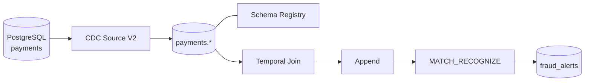

# Arquitetura

## Visão geral

A solução captura alterações do PostgreSQL por logical replication, publica eventos Debezium em Kafka e processa transações com Flink SQL.

## Componentes

| Componente | Responsabilidade |
|---|---|
| PostgreSQL | Tabelas customers, accounts, cards e transactions; publication CDC |
| CDC Source V2 | Captura snapshot inicial e alterações incrementais |
| Kafka | Transporte dos eventos e tópicos de saída do Flink |
| Schema Registry | Contratos Avro e compatibilidade |
| Flink SQL | Startup offset, chaves primárias, Temporal Join, append e detecção |
| fraud_alerts | Tópico de saída da detecção |

## Sequência de processamento

1. O snapshot CDC publica o estado inicial das quatro tabelas.
2. Após validar o snapshot, transactions é configurada para iniciar no offset mais recente; accounts mantém a leitura da dimensão.
3. Flink declara a chave primária de accounts, necessária ao lado dimensional do Temporal Join.
4. Temporal Join associa cada transação à versão da conta válida no `$rowtime` do evento.
5. A tabela enriquecida é alterada para `changelog.mode=append`, como na demonstração de referência.
6. MATCH_RECOGNIZE procura pelo menos três transações positivas do mesmo cartão em até 60 segundos.
7. O resultado é publicado em `fraud_alerts`.

## Semântica temporal

`$rowtime` representa o tempo de evento usado pelo Flink, associado ao registro Kafka. Não é o campo de negócio `created_at` do PostgreSQL. A janela da regra mede a distância entre chegadas dos eventos ao Kafka.

O modo `latest-offset` em transactions impede que os registros históricos do snapshot sejam lidos como transações novas pelo statement de fraude. A dimensão accounts continua sendo lida para alimentar o Temporal Join.

## Limites do modo append

O modo append não é um filtro de INSERT. Eventos Debezium de criação (`c`), leitura de snapshot (`r`) e atualização (`u`) são tratados como novas linhas; eventos de exclusão (`d`) são ignorados. Portanto, atualizações CDC podem contribuir para a contagem de eventos em `MATCH_RECOGNIZE`, enquanto exclusões não geram uma linha de saída. A implementação didática valida a regra com INSERTs novos, mas não oferece reconciliação completa de estado nem semântica de changelog.
