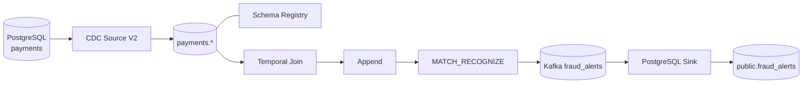

# Arquitetura

## Visão geral

A arquitetura captura alterações do PostgreSQL por logical replication, publica eventos Debezium em Kafka, processa transações com Flink SQL e encaminha os alertas do tópico Kafka para persistência PostgreSQL por Sink.

## Componentes

| Componente | Responsabilidade |
|---|---|
| PostgreSQL | Tabelas customers, accounts, cards e transactions; publication CDC |
| CDC Source V2 | Captura snapshot inicial e alterações incrementais |
| Kafka | Transporte dos eventos e tópicos de saída do Flink |
| Schema Registry | Contratos Avro e compatibilidade |
| Flink SQL | Startup offset, chaves primárias, Temporal Join, append e detecção |
| `fraud_alerts` | Tópico Kafka de saída da detecção |
| PostgreSQL Sink | Consome `fraud_alerts` em Avro e aplica UPSERT |
| `public.fraud_alerts` | Destino PostgreSQL com PK `(card_id, first_txn)` |

## Sequência de processamento

1. O snapshot CDC publica o estado inicial das quatro tabelas.
2. Após validar o snapshot, transactions é configurada para iniciar no offset mais recente; accounts mantém a leitura da dimensão.
3. Flink declara a chave primária de accounts, necessária ao lado dimensional do Temporal Join.
4. Temporal Join associa cada transação à versão da conta válida no `$rowtime` do evento.
5. A tabela enriquecida é alterada para `changelog.mode=append`, como na demonstração de referência.
6. MATCH_RECOGNIZE procura pelo menos três eventos com `amount > 0` do mesmo cartão em até 60 segundos de tempo de evento. Essa condição é didática e não constitui, isoladamente, uma avaliação antifraude.
7. O resultado é publicado no tópico Kafka `fraud_alerts`.
8. O PostgreSQL Sink consome o tópico em Avro e aplica UPSERT em `public.fraud_alerts`, usando `(card_id, first_txn)` como chave.

## Semântica temporal

`$rowtime` representa o tempo de evento usado pelo Flink, associado ao registro Kafka. Não é o campo de negócio `created_at` do PostgreSQL. A janela da regra mede a distância entre chegadas dos eventos ao Kafka.

O modo `latest-offset` em transactions impede que os registros históricos do snapshot sejam lidos como transações novas pelo statement de fraude. A dimensão accounts continua sendo lida para alimentar o Temporal Join.

## Limites do modo append

O modo append não é um filtro de INSERT. Eventos Debezium de criação (`c`), leitura de snapshot (`r`) e atualização (`u`) são tratados como novas linhas; eventos de exclusão (`d`) são ignorados. Portanto, atualizações CDC podem contribuir para a contagem de eventos em `MATCH_RECOGNIZE`, enquanto exclusões não geram uma linha de saída. A implementação didática valida a regra com INSERTs novos, mas não oferece reconciliação completa de estado nem semântica de changelog.

## Persistência e semântica do Sink

A tabela `public.fraud_alerts` é criada pelo SQL de inicialização com os campos `card_id`, `first_txn`, `last_txn` e `txn_count`; a chave primária é `(card_id, first_txn)`, alinhada aos campos emitidos pelo SQL Flink e à configuração `pk.fields` do conector. O Sink usa `insert.mode=UPSERT`, `auto.create=false` e `auto.evolve=false`.

A role PostgreSQL `alerts_sink` recebe CONNECT no banco, USAGE em `public` e SELECT/INSERT/UPDATE na tabela de destino. A Service Account `app-reader` tem leitura no tópico e autorização de grupo `connect-` por prefixo. A role é criada ou tem a senha atualizada pela inicialização, mas atributos elevados e memberships de uma role preexistente não são normalizados; a consulta de auditoria deve ser revisada antes de criar o conector.

UPSERT pode tornar reentregas com a mesma chave idempotentes no destino; não demonstra exactly-once ponta a ponta. O estado `RUNNING` do conector também não prova persistência. A homologação exige correlacionar mensagem conhecida no Kafka com registro no PostgreSQL e testar reentrega controlada.

## Limites funcionais e operacionais

- A condição `amount > 0` não considera, por si só, status da transação, perfil do cliente, localização, frequência histórica ou outros sinais de risco. O resultado deve ser chamado de alerta gerado pela regra, não de fraude confirmada.
- A transformação append não filtra exclusivamente INSERTs CDC. Atualizações podem contribuir como novas linhas e exclusões não são representadas como novas linhas.
- A leitura de um alerta no Kafka e a presença de registros no PostgreSQL não demonstram, isoladamente, correlação causal entre um evento de entrada e um registro persistido.
- A documentação de resultados e limites está em [Homologação e aprendizados](plano-homologacao.md).
